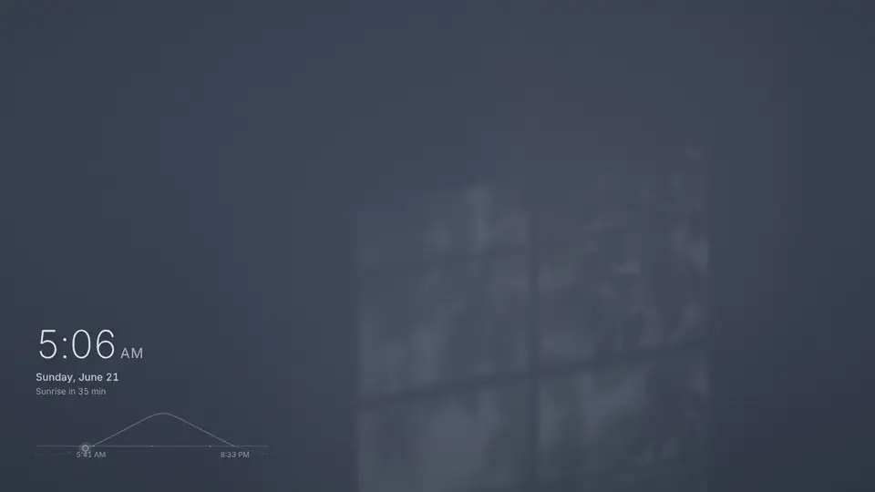
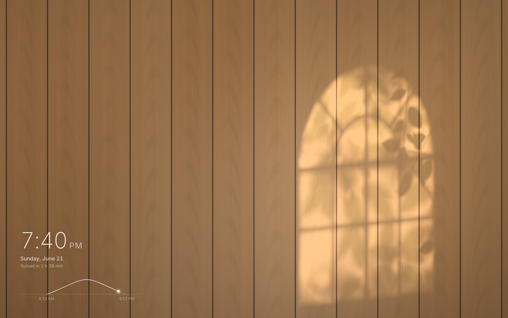
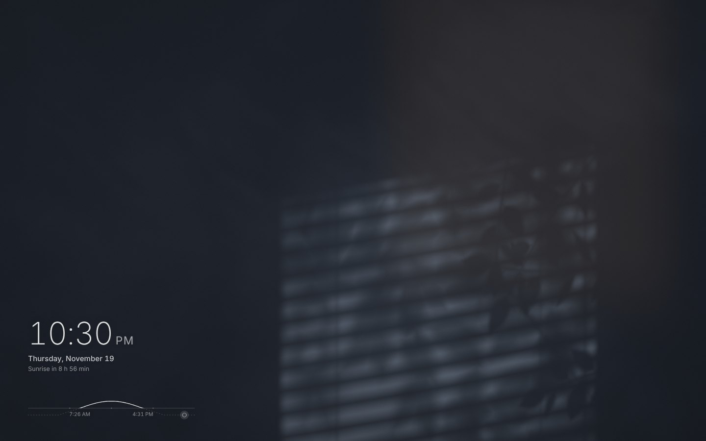

<p align="center"></p>

<h1 align="center">Lull</h1>

<p align="center">A live wallpaper of sunlight falling across a wall, for Mac and Windows.<br>The light follows the real sun where you are, from first light to moonlight.</p>

<p align="center"><a href="https://github.com/stephenp/lull/releases/latest"><b>Download for Mac</b></a> · macOS 13 or later · Apple Silicon and Intel<br>
<a href="https://github.com/stephenp/lull/releases/latest"><b>Download for Windows</b></a> · Windows 10 (2004) or later, 64-bit</p>

[](docs/preview.mp4)

<p align="center"><sub>A June day, sunrise to sunset, in 20 seconds. Click for the full-quality video.</sub></p>

## Screenshots

<table>
  <tr>
    <td colspan="2"></td>
  </tr>
  <tr>
    <td width="50%"></td>
    <td width="50%"></td>
  </tr>
  <tr>
    <td width="50%"></td>
    <td width="50%"></td>
  </tr>
</table>

## Options

Everything lives in a small icon in the Mac menu bar or the Windows system tray:

- **Window:** blinds, a window frame, or a tall arched window
- **Decoration:** none, a tree outside, or a sheer curtain
- **Wall:** knockdown, limewash, or oak panels
- **Dynamic Environment:** a gentle breeze through the leaves, curtain and blinds
- **Show Time:** the time, the date, time until sunset or sunrise, and today's sun curve
- **Preview Day:** scrub through a whole day of light
- **Launch at Login** and **Low Power Mode**

The light's angle, color and warmth follow the real sun at your location, through golden hour into a cool moonlit night. Lull pauses itself while your desktop is covered or your screen is off, so it stays light on your computer.

## Install

Both versions are on the [latest release](https://github.com/stephenp/lull/releases/latest) page. Lull isn't from the App Store or Microsoft Store, and it isn't signed by a registered developer, so both Mac and Windows warn you the first time you open it.

### Mac

1. Download `Lull-<version>.dmg`, open it, and drag Lull into Applications.
2. Open Lull. macOS blocks it the first time with "Apple could not verify Lull". Click **Done**, then go to **System Settings → Privacy & Security** and click **Open Anyway**. On macOS 13–14 you can right-click the app and choose **Open** instead. You only need to do this once.
3. Allow location access, so the light matches the sun where you are. If you skip it, Lull estimates your location from your time zone.

Lull lives in the menu bar (the two slanted bars).

### Windows

1. Download `Lull-<version>-windows.zip`, unzip it, and move `Lull.exe` somewhere permanent, like a `Lull` folder in your user folder. Launch at Login remembers where it is.
2. Double-click `Lull.exe`. If Windows shows "Windows protected your PC", click **More info**, then **Run anyway**. You only need to do this once per version.
3. Allow location access if Windows asks. If it doesn't ask, turn on **Settings → Privacy & security → Location → Let desktop apps access your location**. Without it, Lull estimates your location from your time zone.

Lull lives in the system tray (bottom right, possibly under the **^** arrow). It uses the Microsoft Edge WebView2 Runtime, which comes with Windows 11 and almost every Windows 10 PC; Lull offers a download link if it's missing. If Smart App Control is turned on, Windows blocks unsigned apps entirely, so Lull won't run.

## Build it yourself

**Mac**, with the Xcode Command Line Tools (`xcode-select --install`):

```sh
git clone https://github.com/stephenp/lull.git
cd lull/mac && ./build.sh install
```

**Windows**, with the [.NET 10 SDK](https://dotnet.microsoft.com/download):

```powershell
git clone https://github.com/stephenp/lull.git
cd lull\windows
dotnet publish -c Release -o out
.\out\Lull.exe
```

Both apps are thin native shells around the same scene, [`web/src.html`](web/src.html) (run `python3 web/build.py` after editing it). See [`windows/README.md`](windows/README.md) for how the Windows version works.

## About

Lull started as a personal recreation of [sunstill.app](https://sunstill.app/).

> **Fully vibe-coded with Claude.** Lull was built entirely in conversation with Claude (Anthropic). I described what I wanted, reacted to screenshots and builds, and tested it on my Mac and my Windows PC. Claude wrote all of the code, including the Windows port. It works on my machine, but it hasn't had a careful line-by-line human review.

[MIT](LICENSE) © 2026 Stephen Pontes
