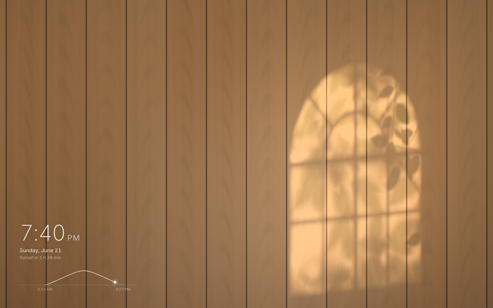
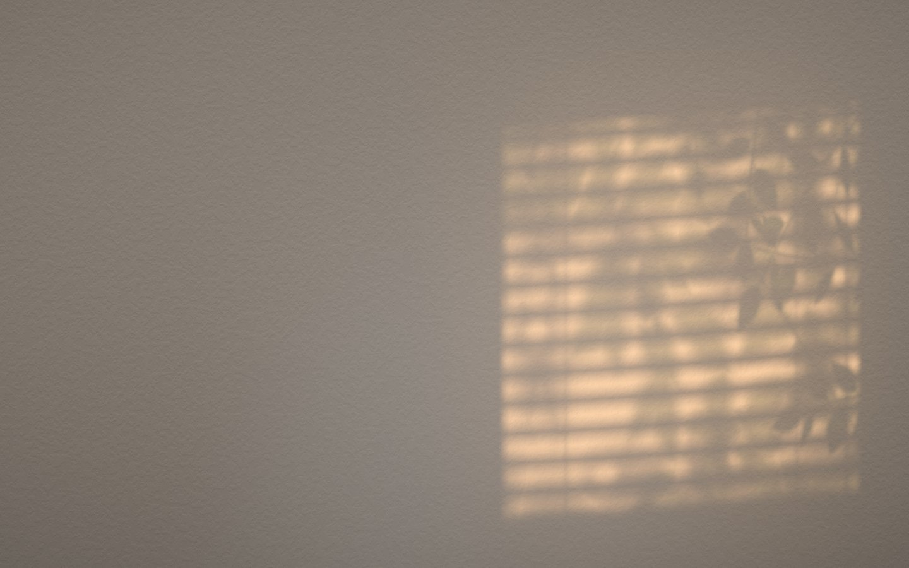
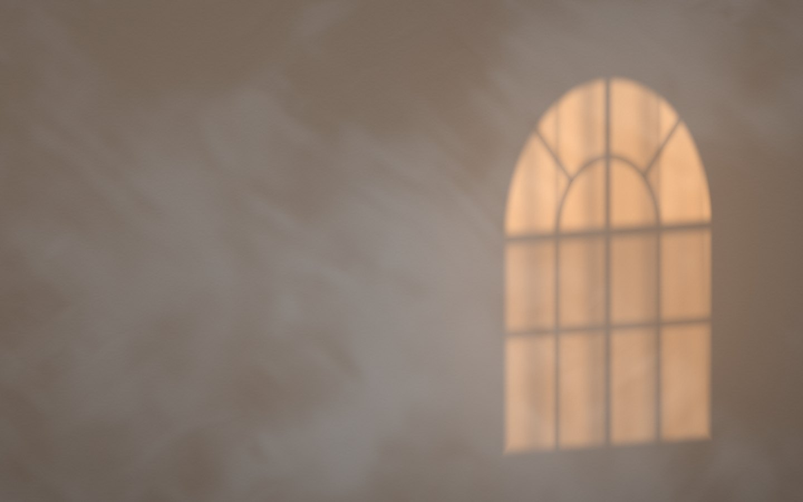

<p align="center"></p>

<h1 align="center">Lull</h1>

<p align="center">A live Mac wallpaper of sunlight falling across a wall.<br>The light follows the real sun where you are, from first light to moonlight.</p>

<p align="center"><a href="https://github.com/stephenp/lull/releases/latest"><b>Download for Mac</b></a> · macOS 13 or later · Apple Silicon and Intel</p>

[](docs/preview.mp4)

<p align="center"><sub>A June day, sunrise to sunset, in 20 seconds. Click for the full-quality video.</sub></p>

## Screenshots

<table>
  <tr>
    <td colspan="2"></td>
  </tr>
  <tr>
    <td width="50%"></td>
    <td width="50%"></td>
  </tr>
  <tr>
    <td width="50%"></td>
    <td width="50%"></td>
  </tr>
</table>

## Options

Everything lives in a small menu bar icon:

- **Window:** blinds, a window frame, or a tall arched window
- **Decoration:** none, a tree outside, or a sheer curtain
- **Wall:** knockdown, limewash, or oak panels
- **Dynamic Environment:** a gentle breeze through the leaves, curtain and blinds
- **Show Time:** the time, the date, time until sunset or sunrise, and today's sun curve
- **Preview Day:** scrub through a whole day of light
- **Launch at Login** and **Low Power Mode**

The light's angle, color and warmth follow the real sun at your location, through golden hour into a cool moonlit night. Lull pauses itself while your desktop is covered, so it stays light on your Mac.

## Install

1. Download `Lull-1.0.dmg` from the [latest release](https://github.com/stephenp/lull/releases/latest) and drag Lull into Applications.
2. Open it. Since Lull isn't from the App Store, macOS blocks it the first time. Go to **System Settings → Privacy & Security** and click **Open Anyway**. On macOS 13–14 you can right-click the app and choose **Open** instead. You only need to do this once.
3. Allow location access, so the light matches the sun where you are.

## Build it yourself

With the Xcode Command Line Tools (`xcode-select --install`):

```sh
git clone https://github.com/stephenp/lull.git
cd lull/mac && ./build.sh install
```

## About

Lull started as a personal recreation of [sunstill.app](https://sunstill.app/).

> **Fully vibe-coded with Claude.** Lull was built entirely in conversation with Claude (Anthropic). I described what I wanted, reacted to screenshots and builds, and tested it on my Mac. Claude wrote all of the code. It works on my machine, but it hasn't had a careful line-by-line human review.

[MIT](LICENSE) © 2026 Stephen Pontes
